# How freshVision decodes composite and S-Video

A technical page: how a composite or S-Video signal on the capture card's
**green** input becomes a colour picture in freshVision and freshCoder. You
don't need it to use the programs (see the [freshVision reference](freshvision.md)),
but it explains what the decoding options do.

The examples are a Commodore 64 (PAL) running Commando's title screen,
captured on 2026-10-03 with a VisionHD4.

## 1. Sampling locked to the colour carrier

The card's analog input normally samples an RGB picture: it locks to the
line sync and takes a set number of samples per line (the card's
**Horizontal Size** control). On the green input it also syncs on a
composite signal ("Sync-on-Green").

freshVision chooses that number so that **every cycle of the colour carrier
gets exactly K samples**. A PAL C64 line has 283.5 carrier cycles, so:

| Sampling | Samples per line (Horizontal Size) | Sample rate |
|---|---|---|
| 4x | 1134 | 17.7 MHz |
| 8x | 2268 | 35.5 MHz |
| 10x | 2835 | 44.3 MHz |

(Standard PAL is 283.75 cycles per line, 1135 at 4x; the machine profile
sets the right number.) The capture window (**Horizontal Position** and
**Timing**) chooses which samples are kept, here 2048 of them from just after
the sync, and the one-channel `g8` format delivers each sample as one byte.

Above 10x the card doesn't deliver whole PAL frames: at 12x and 14x the lower
part of many frames breaks, and above that the picture is unusable. NTSC at
12x (43 MHz) works.

This is what the card delivers, one frame of raw samples (scaled to fit the
page):

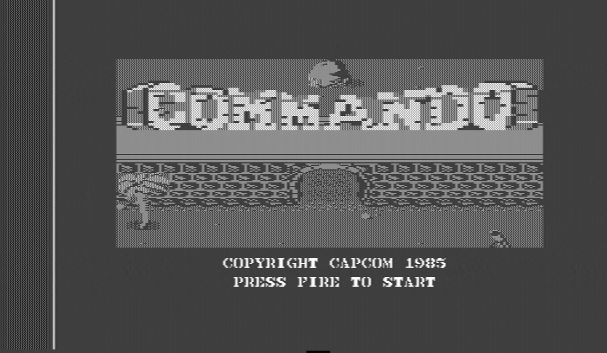

The colour is in there as a fine pattern. Zoomed in four times on the logo,
every sample a block:

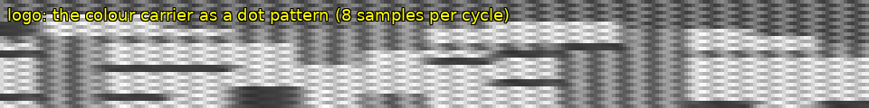

One line through the logo as a waveform, and its start in detail:

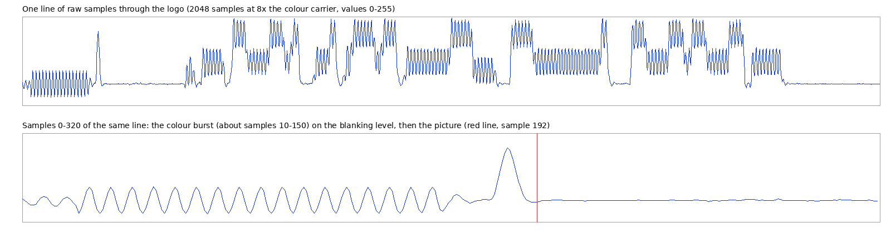

The burst (the first part of the line) is a short piece of the colour carrier
with a fixed phase and size. The picture follows: brightness is the slow
level, colour is the fast wave riding on it. Its **amplitude is the
saturation, and its phase against the burst is the hue**.

## 2. Colour reference: the burst

On every line the decoder finds the burst. From it come:

- **the colour reference**: the burst's phase sets the phase every colour on
  that line is measured against;
- **the colour gain**: colour is scaled against the burst's size, as a TV's
  colour control does, so the picture's colour doesn't depend on the levels;
- **the black level**: the blanking level around the burst.

Because the sampling is locked to the carrier, the carrier's phase moves by a
fixed amount from line to line (for the C64, half a cycle). freshVision
measures that step on every frame. It tells whether the line length is right
(the auto-tune uses it), and drives a software **PLL** that follows small
drifts of the machine's colour clock (**Follow the colour carrier**, **PLL
speed**).

## 3. Colour: demodulation

For each sample the decoder multiplies the signal with the carrier at the
burst's phase and averages the result over a window of carrier cycles. That
gives the two colour components (U and V). **colour smoothing** is that
window's length: 2 cycles is the sharpest colour; more fades the colour
fringes around fine brightness detail, at the cost of colour resolution.

PAL ("Phase Alternating Line") flips the sign of V on every other line. The
decoder has to know which lines are flipped. It works that out from the line
length (the expected step of the carrier from line to line), because the
burst alone is ambiguous here.

**Average colour of line pairs** is the PAL delay-line method: the colour of
two neighbouring lines is averaged, so a phase error (which tilts the hue one
way on one line and the other way on the next) cancels out instead of showing
as "Hanover bars". On the C64 used here the colour is very steady: on the
example frame averaging changes the picture by 1 code on average (at most 27,
at a few edges), so it makes little visible difference. On a machine with a
less stable colour clock it matters more.

## 4. Brightness: removing the carrier

The brightness is the signal with the carrier taken out. Three filters:

- **Notch** (default): removes just the carrier frequency; sharp.
- **Box**: averages over one carrier cycle; softer.
- **Off**: no filter; the carrier stays in as a dot pattern on coloured areas.

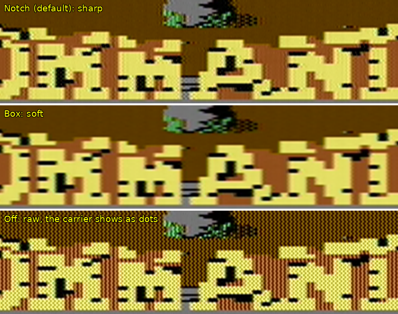

Because brightness and colour share the same frequencies in a composite
signal, fine brightness detail can show as false colour ("cross-colour") and
colour edges as dots. That is how composite looks on any TV. S-Video avoids it.

## 5. Clock stripes

A computer's own clock leaks a little into its video. On the C64 it shows as
faint vertical stripes, one character column (36 samples at 8x) wide, locked
to the line. **Remove fixed clock stripes** learns that pattern from flat parts
of the picture over a few seconds and subtracts it from the samples. Nothing
is filtered, so the sharpness stays. On the example C64 the learned pattern
was about 0.4 codes (rms): faint, but visible on flat areas.

## 6. Levels: auto-tune

The card's input is made for RGB: it clamps the black level and clips
everything below it. A composite signal goes below black (the sync, and the
lower half of the burst and of saturated colours). **Auto-tune** sets the
green input's **Brightness** (black level) and **Contrast** (swing) so that the
whole signal, burst included, lies inside the 0-255 range with headroom, and
reads the line length from the carrier step. It changes one step at a time,
waits for the picture to settle, until the levels are in range.

## 7. S-Video

S-Video carries brightness with the sync (Y) and colour (C) on two wires.
freshVision takes Y on the green input and C on the blue (or red) input, in a
three-channel capture. The card samples all three inputs at the same moments,
so Y and C line up exactly.

- Y is the brightness directly: no carrier to remove, no notch filter, no
  cross-colour.
- C is demodulated exactly as in composite, against the burst on C.

The result is sharper brightness and cleaner colour edges than composite.

The two raw planes of one frame (the same C64, S-Video cable):

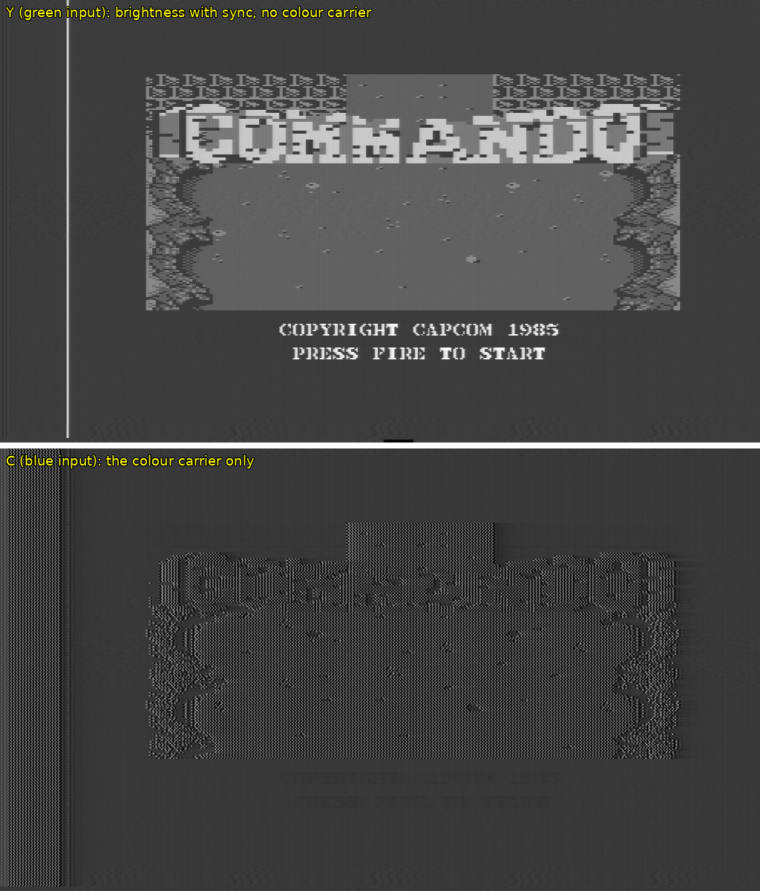

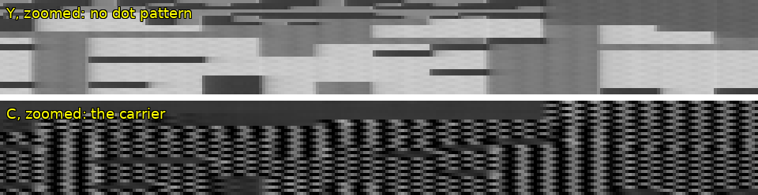

Decoded:

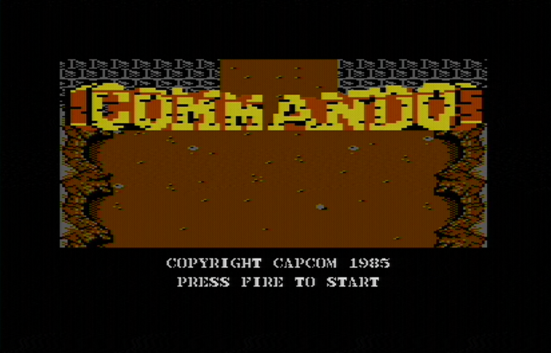

The text from composite and from S-Video:

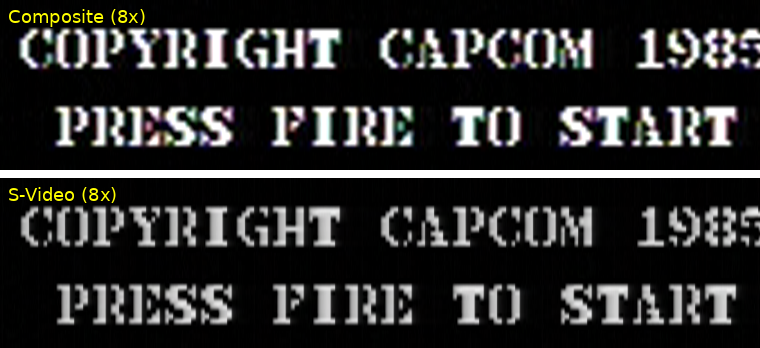

## 8. Machine pixels and palettes

A home computer draws a fixed grid of pixels from a small palette. With
**Pixel grid** on, freshVision finds that grid (the C64's pixel is 4.5 samples
at 8x) and samples each pixel from its settled centre. With **Snap to the
palette**, each pixel becomes the nearest colour of the machine's documented
palette (calibrated from the picture). The chip rules (**C64 cells**, **TMS9918:
2 colours per 8 pixels**) decide colours per cell first. The colour in
composite is spread over several pixels, so single-pixel colour detail can't
always be recovered.

## 9. Compared: software decoding and a hardware PAL decoder

The same C64 composite signal, decoded two ways: by freshVision (8x) and by an
ETRON IN1502 PAL decoder, which turns composite into RGB that the card then
captures on another input (672x504). Both run at 50 frames/s. The frames are a
moment apart, so the scrolling background differs.

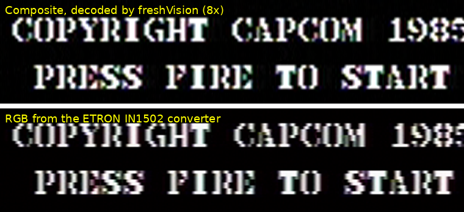

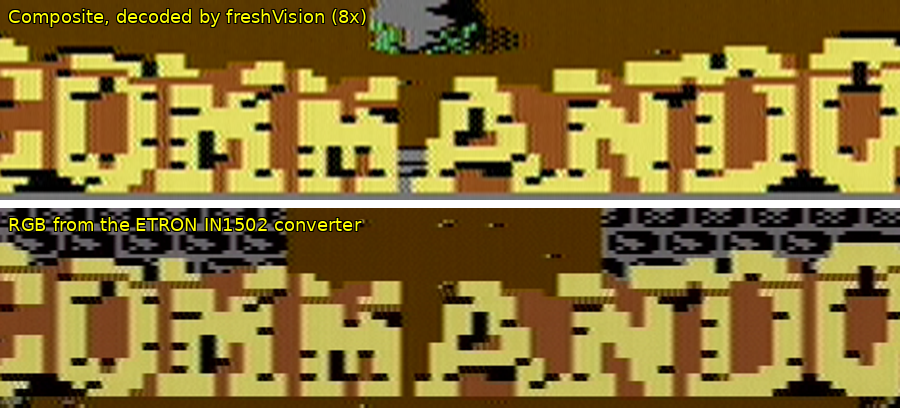

Measured on the text above (both crops scaled to the same size):

| | freshVision, 8x | ETRON converter |
|---|---|---|
| Edge sharpness (mean brightness step between neighbouring pixels) | 9.8 | 8.2 |
| Colour fringing on the letters' edges (mean spread of R, G, B in the edge pixels) | 19.8 | 10.2 |

freshVision's decoding is about 20% sharper, and the converter's picture has
about half the colour fringing; it also shows a visible line structure. In flat colour areas the two look alike. (One frame each, so
take these as an indication. **colour smoothing** or **edge colour
reduction** lower freshVision's fringing at some cost in colour sharpness, and
S-Video avoids it altogether.) The whole frames:

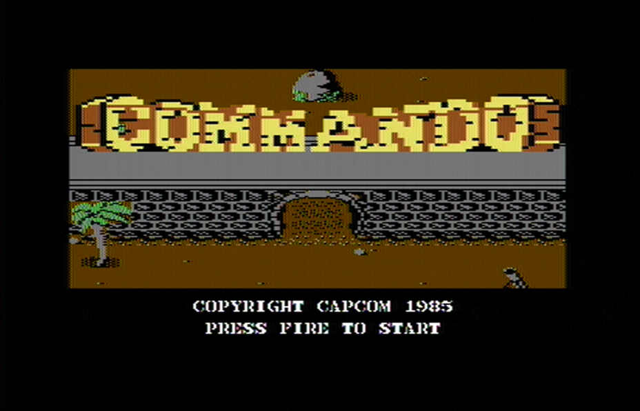

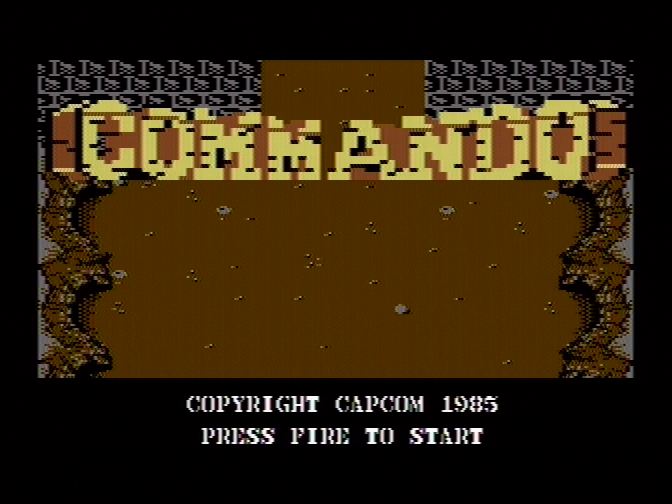

## 10. NTSC: what differs

The method is the same; the details differ:

- **Carrier and line**: 3.579545 MHz, 227.5 cycles per line for standard NTSC
  and the C64 NTSC (910 samples at 4x), 228 for the Apple II and MSX1 (912).
  NTSC also offers **6x** and **12x** sampling; at 12x an MSX1 pixel is exactly
  8 samples.
- **No phase alternation**: the burst sits at 180 degrees on every line and
  the hue is measured directly against it. There is no V-switch to decide, and
  hue errors are not averaged out, which is why NTSC TVs have a hue control
  (freshVision's **hue**).
- **Machines that bend the standard**:
  - The MSX1's video chip sends a weak burst (about a quarter of the standard
    size) and a coloured border right after it. freshVision's MSX profile
    scales the brightness accordingly and only looks for the burst where the
    standard puts it.
  - The Apple IIc's colour burst runs through its vertical sync, and the card
    then holds its picture only about 8 times a second in colour graphics.
    **Re-align rolling frames** turns each frame it does deliver to the right
    position.
