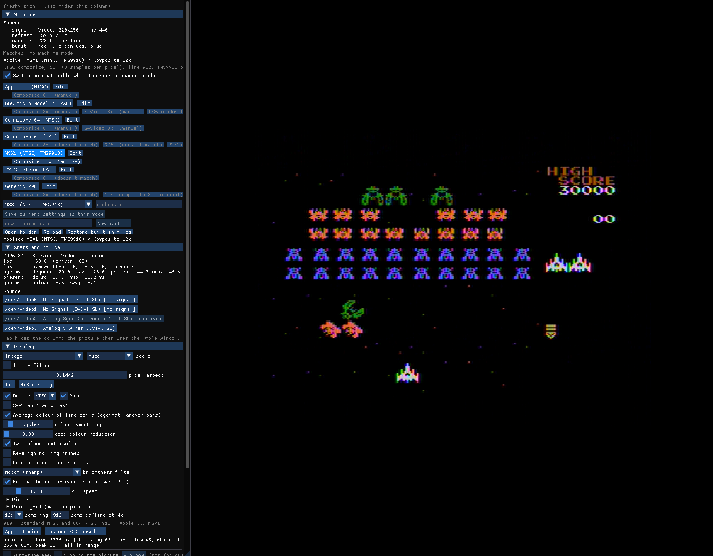
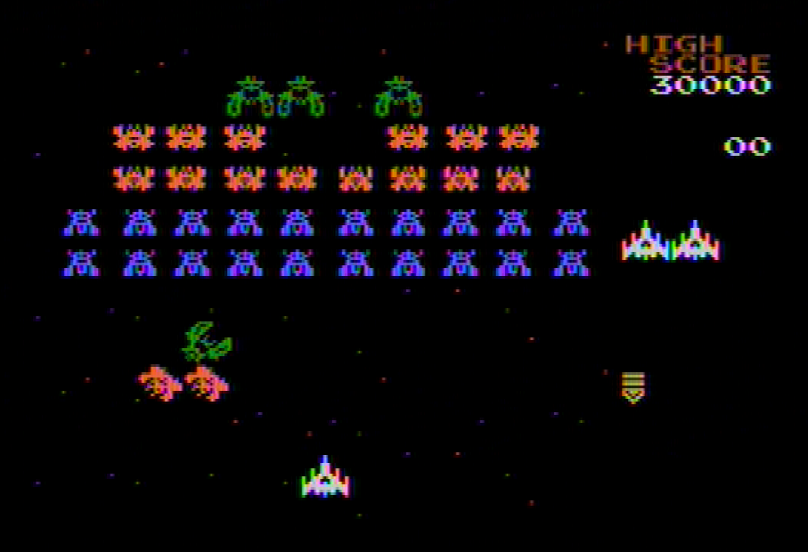
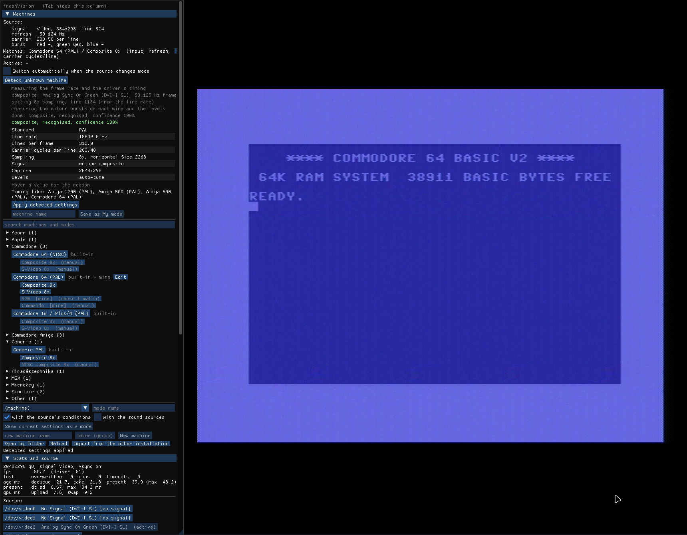

# freshVision reference

The window has a **control column** on the left (sections that open and close
with a click on their title; drag its edge to make it wider) and the
**picture** beside it.



*An MSX1 (Casio MX-10) playing Galaga on plain composite, decoded in software (NTSC, 12x
sampling, 60 frames/s). The picture alone; with **Tab** the column hides and the picture uses
the whole window:*



## Keys

| Key | Does |
|---|---|
| **Tab** | hide/show the control column (the picture then uses the whole window) |
| **F** or **F11** | fullscreen on/off |
| **V** | vertical sync on/off (off: lowest latency, possible tearing) |
| **Q** or **Esc** | quit |

The keys don't act while you type in a text field.

## Stats and source

- **Stats**: frame size and format, frames per second shown and delivered by
  the driver, frames overwritten (the display skipped them), driver gaps,
  timeouts, frame age (how old a frame is when it reaches the screen), and the
  time spent processing and showing each frame.
- **Source**: the card's inputs (`/dev/videoN`) with what each detects and
  whether it has a signal. A click switches to that input.

## Display

**scale**: how the picture fills its area.

- **Integer**: the picture is shown at a whole multiple of its size, centred;
  every source pixel becomes the same number of screen pixels (sharp, no
  uneven pixels). Next to it: **Auto** (the largest multiple that fits) or a
  fixed **1x-4x** (kept whatever the window size; "too big" marks a factor
  that doesn't fit the screen).
- **Fit**: as large as fits, keeping the aspect ratio.
- **Stretch**: fills the area.

**linear filter**: smooth scaling instead of sharp pixels. **pixel aspect**:
the width of a pixel against its height, for sources whose pixels aren't
square; **1:1** sets square pixels, **4:3 display** the aspect that makes the
whole picture 4:3.

### Decoding composite and S-Video

**Decode** [**PAL** / **NTSC**]: decodes the composite colour signal on the
green input (see [Connecting](wiring.md); how it works, with pictures:
[How the decoding works](decoding.md)). Needs the `g8` format (one channel)
or an RGB format. SECAM is not supported.

- **Auto-tune**: sets the line length (from the colour carrier), the black
  level (Green Brightness) and the swing (Green Contrast) so nothing clips.
  Waits 1.5 s after each change; takes a few seconds to settle.
- **S-Video (two wires)**: brightness with sync on green, colour on **Blue**
  (or **Red**). Ticking it on a `g8` capture switches to an RGB format, since
  two inputs are needed.
- **sampling**: how many samples per colour-carrier cycle: **4x**, **8x** or
  **10x** (NTSC also **6x** and **12x**). More is sharper and costs more CPU;
  8x is the usual choice. 12x is not offered for PAL: the card doesn't deliver
  whole frames there.
- **samples/line at 4x**: the source's line length at 4x. 1135 is standard
  PAL, **1134 the Commodore 64**; NTSC 910 (standard and C64 NTSC), 912 (Apple
  II, MSX1). The machine modes set it.
- **Apply timing** sets the card to that sampling (the device is reopened);
  **Restore SoG baseline** puts the card's default Sync-on-Green timing back.
  **Card's detected timing** is the starting point for a machine freshVision
  doesn't know yet: decoding and auto-tune go off and the card's own timing for
  the signal it detects comes back, so you see the plain (green) picture as the
  card captures it and can refine it from there (`--pal-timing card`).

Decoding options (below the timing):

- **Black and white source (no colour burst)**: for a machine without colour
  (the Microkey Primo): no burst is looked for, black is taken on each line,
  and the picture is grey instead of green (`--pal-mono`).
- **Average colour of line pairs**: the PAL method against "Hanover bars"
  (alternating line colour errors). On by default.
- **colour smoothing**: how many carrier cycles the colour is averaged over.
  2 = sharpest colour; more fades the colour fringes around fine detail (MSX1
  text), like a TV's narrow colour filter.
- **edge colour reduction**: less colour where the brightness has fine
  detail (where composite's fringes sit). 0 = off.
- **Two-colour text (soft)**: for text screens with one background and one
  text colour (MSX BASIC): both colours snapped to the machine's palette, every
  point a blend of them. No fringes, no flicker. It switches itself off on
  colourful screens.
- **Re-align rolling frames**: for a source whose vertical sync the card
  doesn't hold (the Apple IIc): each frame is turned so its vertical sync
  comes first. Needs the whole frame captured and the black lifted above sync
  (auto-tune does that).
- **Remove fixed clock stripes**: learns the faint vertical stripes a
  computer's own clock leaves in its video (C64: one character column wide)
  from flat parts of the picture and subtracts them. Nothing is filtered, so
  sharpness stays.
- **brightness filter**: **Notch** (sharp, default), **Box** (soft) or
  **Off** (raw, the carrier shows as dots).
- **Follow the colour carrier (software PLL)** with **PLL speed**: tracks a
  machine whose colour clock drifts (low = steady, high = follows quickly).
- **Picture**: brightness, contrast, saturation, hue, gamma; **Reset picture**.
- **Pixel grid (machine pixels)**: finds the machine's own pixels (choose the
  **machine** profile) and samples each one from its settled centre (**pixel
  core**: how much of each pixel is averaged). **Snap to the palette**: every
  pixel becomes the nearest colour of the **palette**: the machine's documented
  one, a **custom** one (`~/.config/freshvision/palettes/*.gpl`; edit it here,
  **Add colour**, **Remove last**, **Load**, **Save**) or one learned from the
  picture. **C64 cells** (2 colours per 8x8 cell, 4 in multicolour) and
  **TMS9918: 2 colours per 8 pixels** (MSX1) apply those chips' own colour
  rules. **Re-detect grid** searches again.

### RGB

- **Auto-tune RGB**: for analog RGB, finds the sharpest sampling **Phase** and
  centres the picture (Horizontal/Vertical Position). Runs now and after every
  mode change. **Run now** repeats it.
- **crop to the picture**: also crops to the drawn picture (off by default: a
  black border makes the crop follow what is drawn, not the screen).
- **screen size** / **use measured**: the machine's whole screen in capture
  pixels, border included. With it, a black border no longer misleads the
  auto-tune. Take it once while the border is visible, then save the mode.

## Controls

Every control the card's driver offers for the current input, found at run
time: picture (Brightness, Contrast, per-colour levels), timing (Horizontal
Size, Position, Timing, Vertical Position and Timing, Phase), and others.
Sliders with a number field next to them; a reset button appears when a
control is away from its default; **Reset all to defaults**.

The card keeps its controls between runs, also for other programs.

## Geometry

**width/height** + **Apply size**: the capture size. **crop x/y/w/h** +
**Apply crop**: capture only that part of the source; **Reset crop**. **Fit
active area (720x576 DVI)** for a 720x576 digital source.

## Recorder

- **folder** (with **Browse...**) and **file name** (empty =
  `freshvision-<date>_<time>.mkv`). Existing files are never overwritten.
- **encoder**: only the encoders that work on this computer are listed
  (checked at start): **Auto** (the first that works of NVENC, VAAPI, x264),
  **NVENC (H.264)** on an NVIDIA card, **VAAPI (H.264)** on Intel/AMD
  graphics, **x264 (H.264)** in software, **FFV1 (lossless)**, **Uncompressed
  (lossless)**. The line under it says what Auto uses and the size, frame rate
  and sound (always PCM stereo 48 kHz).
- **Start recording** / **Stop recording**; while recording: time, frames,
  dropped frames, size and data rate.
- **Open folder** opens the folder in the file manager; **Open in freshCoder**
  opens the last recording in freshCoder.
- The recording's size is fixed when it starts; a later mode change is scaled
  into it. If the computer can't keep up (more than 1 s per frame for 3 s), the
  recording is stopped and finished by itself, and the reason is shown.

Recording a composite (`g8`) source as **FFV1** or **Uncompressed** keeps the raw samples
(about 740 MB per minute at 8x) and every setting as a tag: freshCoder can
decode it again later with other settings.

## Audio

- **Monitor output**: the device you listen on (`default`, or a hardware
  device); **Start monitor** / **Stop monitor**. For a hardware device,
  **Mute (hw)** and **Output volume (hw)** use that card's own mixer.
- **Line the picture up with the monitor sound**: holds the picture back by
  whole frames so it matches the sound you hear (adds that much picture
  latency; recordings aren't affected). The measured sound and picture delays
  are shown.
- **Record**: the sound mix to a WAV file (16-bit).
- **Devices**: every sound input; tick one to add it as a source. Per source:
  **mode** (Left, Right, Stereo, Separate L/R), which **output** channel it
  goes to, hardware **mute/volume/balance** if the device has them (else
  software volume and balance), **input jack** (on cards with several), and a
  **delay** (0-500 ms) to line sound and picture up.
- **Audio/system clock drift**: how far the sound card's clock drifts from the
  computer's, shown after a source has run a few seconds.

## Machines and modes

A **machine** (for example "Commodore 64 (PAL)") has **modes** ("Composite
8x", "S-Video 8x", "RGB", ...). A mode holds every setting freshVision has
(format, size, card controls, display and decoding, encoder, optionally the
sound sources) and, if you want, **conditions**: when the source looks like
this (input, size, line length, refresh rate, colour carrier, whether an input
carries colour), freshVision picks the mode by itself. A mode without
conditions is applied only by a click (what other programs call a preset).

There are two kinds:

- **Built-in** modes ship with freshVision. They are replaced by every
  upgrade, so improvements reach you, and you can't overwrite them.
- **My modes** are yours, in your settings folder. Upgrades never change
  them. Your own machines (any computer you add), your own modes, and your
  tuned versions of built-in modes live here.

### Using it

- **Source**: what the card sees now. **Matches**: the best mode for it, with
  **Apply**. **Active**: the mode in use.
- **Switch automatically when the source changes mode**: freshVision applies
  the matching mode by itself a few seconds after the source changes (when
  you switch the computer on, or from text to graphics). While a recording
  runs it doesn't switch (the file keeps one format). Modes marked
  "(manual)" are only applied by a click (machines with the same timing,
  like a ZX Spectrum and a BBC Micro, can't be told apart).
- Machines are **grouped by maker** (Commodore, Sinclair, Acorn, ...); a group
  opens with a click, and the group of the active or matching machine is
  open. The **search** box finds machines and modes by name.
- Each mode is a button: a click applies it, even if its conditions don't fit
  right now. Its marks: **[mine]** (your own mode), **[replaced by yours]**
  (your version of a built-in mode, with a **back to built-in** button next
  to it). **Right-click** a mode for more: the differences from the built-in
  mode, back to built-in, delete, or hide a built-in mode you never use
  (hidden ones are listed under the machine with a **show** button).

### Detect unknown machine

For a computer freshVision doesn't know yet, **Detect unknown machine** (experimental; or
the option `--detect`) measures the source for a few seconds and proposes
settings. Nothing changes until you click.



- It works on every kind of input: **digital** (DVI/HDMI: the size and
  pixels sent twice or more; no crop), **analog RGB** (the
  sampling, the picture's size; phase and position follow from the RGB
  auto-tune), **composite** and **S-Video** on the Sync-on-Green input
  (PAL or NTSC from the frame rate, colour or black and white from the colour
  burst, which wire carries the colour, the line length from the line rate
  and the colour carrier, 8x sampling; the levels follow from auto-tune).
- For composite, the capture switches to RGB at 8x while it measures, so it
  can see the colour burst on every wire.
- The result shows each setting with its reason (hover the value), a
  confidence, warnings (for example when the card locked onto twice the
  line rate: re-plug the cable), and the known machines with the same
  timing ("Timing like").
- **Apply detected settings** uses them; **Save as My mode** stores them as
  a new machine in the group "Detected" (click-only), which you can tune and
  save over like any other mode.
- For composite and S-Video no pixel clock is shown: from one picture a
  pixel can't be told from a double-wide one. On RGB, the sampling is changed
  only when the pixel grid is clear.
- A digital source is captured 1:1 at the size the card detects, black bars
  included (crop afterwards if needed: a PC screen can be almost all black).
  Pixels sent twice or more are only reported, never changed. A scaler that smooths its
  output (for example a C64 through a RetroScaler2x line doubler) reads as
  "as sent", because its doubled lines are not exact copies.

### Saving

The save row follows the active machine and mode. Above the **Save current
settings as a mode** button, **Changes since the mode was applied** lists
what you changed since the mode was applied (the PLL speed, a control, ...):
exactly what Save takes over.

- **Saving over the active mode** stores the mode as it was plus your
  changes. Saving over a built-in mode creates your version of it ("replaced
  by yours"); the built-in mode stays available. Its conditions stay as they
  were. A measured refresh or carrier outside the mode's tolerance is taken
  over (a machine with a slightly different crystal is then still
  recognised).
- **A new mode name** creates a new mode in My modes:
  - **with the source's conditions**: picked by itself when the source looks
    like this again;
  - without them: click-only;
  - **with the sound sources**: the mode also sets up the sound.
- **New machine** (with a maker for the grouping) creates a machine of your
  own; set the source up, then save its modes.
- When one of your modes and a built-in mode match the source equally well,
  **yours is picked**.

### Upgrades

When a new version of freshVision brings a newer version of a built-in mode
you have your own version of, the Machines section shows it at the top:
**Keep mine**, **Take the built-in one**, or **Differences** (what yours does
differently). Nothing changes until you choose; "Keep mine" is remembered for
that version. Built-in modes you didn't change simply become the new ones.

A setting that a later version adds takes the built-in mode's value (or the
program default) in your saved modes. Settings an older version doesn't know
are kept in your files untouched.

### Files

Your modes are plain text, one file per machine, in
`~/.config/freshvision/machines/` (inside the Flatpak:
`~/.var/app/io.github.frescho.freshVision/config/freshvision/machines/`).
**Open my folder** opens it; **Edit** opens a machine's file; **Reload** reads
the folder again (it also notices changes by itself). Values marked
`# default` had the program's default value when saved.

```ini
[machine]
format_version=2
name=Commodore 64 (PAL)
[mode S-Video 8x]
based_on=1
match_input=Sync On Green
match_refresh=50.125 +-0.02
match_colour_on=blue
match_priority=1
pal_pll_speed=0.25
crop_set=0  # default
...
```

The built-in files ship with the program (`/usr/share/freshvision/machines/`
or `~/.local/share/freshvision/machines/`, depending on the installation;
in the Flatpak inside the app). **Import from the other installation**
copies your modes (and freshCoder settings, palettes) between the installed
version and the Flatpak, keeping files you already have.

Built in: generic PAL and NTSC, Commodore 64 (PAL and NTSC), ZX Spectrum, BBC
Micro Model B, MSX1 (NTSC), Apple II. Only the C64 (PAL), the MSX1 and the
Apple IIc have been tested with real machines.

### Coming from freshVision before 0.1.0

The first start converts the old settings once: copies of built-in files that
you never changed become built-in again, your own and changed modes stay
yours (a changed copy is announced as an upgrade, so you can take the
built-in version), and **presets become click-only modes** (a preset group
"C64" goes to the C64 machine, other groups become machines of that name).
The old folders are kept as `machines.backup-0.1.0` and `presets.old`.

## Command line

`freshvision --help` lists every option. The most useful:

| Option | Does |
|---|---|
| `--device /dev/videoN` | open that input (default: the last one that worked, else the first with a signal) |
| `--list-devices` | list the card's inputs, what they detect and whether they have a signal |
| `--info` | print the input's formats and every control, then exit |
| `--machine NAME[/MODE]` | start in a machine's mode, e.g. `--machine "Commodore 64 (PAL)/Composite 8x"`; without `/MODE` the machine's best-fitting mode (its click-only modes included) |
| `--list-machines` | print the machines and their modes (built-in, mine, replaced) |
| `--load-preset NAME` (`--preset-group GROUP`) | apply the mode NAME (of machine GROUP) at start; `--save-preset NAME` saves the current settings as a click-only mode |
| `--record-video FILE` | start recording (`--record-encoder auto`, `x264`, `nvenc`, `ffv1` or `raw`); with `--machine`, `--load-preset` or `--pal-timing` it starts once that setup is in place |
| `--audio-source DEV[,left/right/stereo]` | add a sound input at start, e.g. `hw:CARD=PCH,DEV=0,left` |
| `--ctrl "Name=Value" --no-stream` | set a card control and exit |
| `--fullscreen`, `--no-gui` | start fullscreen / with the control column hidden |
| `--i-know-it-may-freeze` | allow RGB capture without `intel_iommu=off` |
| `--version` | print the version |
