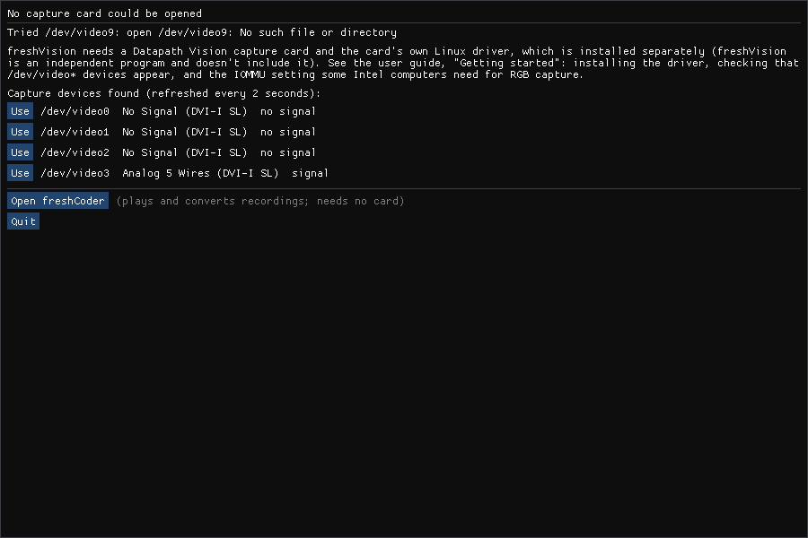

# Getting started

## What you need

- A **Datapath Vision** capture card. freshVision is developed and tested on a
  **VisionHD4** (four DVI-I inputs, analog and digital). Other cards of the
  family use the same Linux driver and may work; they are untested.
- A 64-bit Linux desktop: developed on Linux Mint 22 (Ubuntu 24.04 base,
  kernel 6.8). Other distributions work if the card's driver builds for their
  kernel.
- An OpenGL 3.2 graphics card or chip. For hardware video encoding, an NVIDIA
  card with NVENC (optional; x264 and the lossless FFV1 always work).
- For sound: any ALSA sound input (the line-in of the computer's sound card).

## 1. Install the card's driver

The card needs its maker's Linux driver. **It is not part of freshVision and
freshVision can't install it for you.** Download the Linux driver for your
card from Datapath's support website and install it following the
instructions that come with it.

Notes:

- The driver is a kernel module. When the kernel is updated, the driver may
  have to be built or installed again (follow the maker's instructions).
- With **Secure Boot** on, the kernel only loads signed modules. If the driver
  doesn't load after installation, check the maker's instructions on Secure
  Boot (signing the module or turning Secure Boot off). On the development PC
  the kernel log shows "module verification failed ... tainting kernel" when
  the driver loads: that message is harmless.

### Check that the driver works

After installing (and usually a reboot), the card's inputs appear as video
devices:

```sh
ls /dev/video*
freshvision --list-devices
```

`--list-devices` prints one line per input, for example:

```
/dev/video0   driver Vision     No Signal (DVI-I SL)                     no signal
/dev/video2   driver Vision     Analog Sync On Green (DVI-I SL)          signal
/dev/video3   driver Vision     Analog 5 Wires (DVI-I SL)                signal
```

Each input of the card is one `/dev/videoN`. The name after the driver is
what the card detects on that input right now; "signal" means a picture is
arriving. If your user can't open the devices, add yourself to the `video`
group (`sudo usermod -aG video $USER`, then log out and in).

## 2. The IOMMU setting (Intel computers)

On the development PC (Intel, Linux 6.8), **capturing in an RGB format froze
the whole computer within seconds** while the Intel IOMMU was on, every time.
With the kernel option `intel_iommu=off` it runs without problems. YUV formats
were not affected. Whether other computers (other Intel chipsets, AMD) need
this is **not known**: try without it first, and if RGB capture freezes the
computer, set it.

Because of this, freshVision **refuses RGB capture** unless the kernel was
started with `intel_iommu=off` (it checks `/proc/cmdline`). If you know your
computer is fine without it, start freshVision with `--i-know-it-may-freeze`
to capture RGB anyway.

What turning the IOMMU off means: the IOMMU protects memory from devices that
write into it (DMA). Without it, a faulty or malicious device (for example on
Thunderbolt) is not stopped. On a desktop PC without such devices this is
the way PCs worked for decades, but you should know it.

### Setting it

**Debian, Ubuntu, Linux Mint** (GRUB):

```sh
echo 'GRUB_CMDLINE_LINUX_DEFAULT="$GRUB_CMDLINE_LINUX_DEFAULT intel_iommu=off"' \
  | sudo tee /etc/default/grub.d/99-freshvision-iommu.cfg
sudo update-grub
```

Reboot, then check: `cat /proc/cmdline` must contain `intel_iommu=off`.

Undo: `sudo rm /etc/default/grub.d/99-freshvision-iommu.cfg && sudo update-grub`, reboot.

**Fedora** (grubby):

```sh
sudo grubby --update-kernel=ALL --args="intel_iommu=off"
```

Undo: `sudo grubby --update-kernel=ALL --remove-args="intel_iommu=off"`.

**Arch Linux, openSUSE and others with GRUB**: add `intel_iommu=off` inside the
quotes of `GRUB_CMDLINE_LINUX_DEFAULT` in `/etc/default/grub`, then rebuild the
menu: `sudo grub-mkconfig -o /boot/grub/grub.cfg` (Arch) or
`sudo grub2-mkconfig -o /boot/grub2/grub.cfg` (openSUSE; YaST's boot loader
module can do the same). With **systemd-boot**, add it to the `options` line of
your entry in `/boot/loader/entries/`. Undo by removing it the same way.

(The commands for distributions other than Mint are the usual ones for those
systems; they were not run on them for this guide.)

## 3. Install freshVision

Two ways:

- **Flatpak** (any distribution with Flatpak): download
  `freshVision-<version>.flatpak` from the GitHub release page and install it:
  `flatpak install --user freshVision-<version>.flatpak`. The card's driver
  and the IOMMU setting are still needed on the system itself.
- **From source** with the build script (Debian/Ubuntu/Mint, Fedora, Arch,
  openSUSE): see [Building from source](building.md). In short:

  ```sh
  ./build.sh --user-install
  ```

  This checks the build dependencies (it shows the install command and asks
  first), builds, and installs both programs with their menu entries into
  `~/.local`.

## 4. First start

Start **freshVision** from the desktop menu (or run `freshvision`).

- It opens the input you used last time; the first time, the first card input
  with a signal. With no card or no driver it shows a window that says so and
  lists the video devices it found, with a button to use each one:

  
- The **control column** is on the left, the picture beside it. **Tab** hides
  and shows the column; **F** or **F11** toggles fullscreen; **Q** or **Esc** quits.
- For the machines it knows (Commodore 64, ZX Spectrum, BBC Micro, MSX1,
  Apple II and generic PAL/NTSC), the **Machines** section shows which machine
  and mode match the signal, and freshVision switches to that mode by itself
  a few seconds after the source changes (you can turn that off).
- Settings are kept in `~/.config/freshvision/` (your machine modes,
  palettes, the last device and window size). Recordings go to your Videos
  folder by default.

Next: [Connecting your computer](wiring.md) and the [freshVision reference](freshvision.md).
