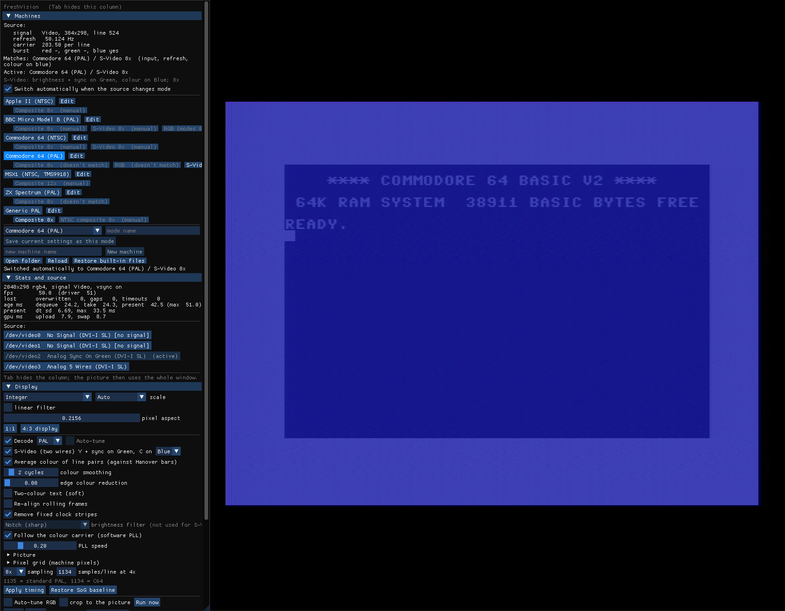

# Connecting your computer

The VisionHD4's inputs are **DVI-I** sockets: they take digital DVI and analog
VGA-style signals (with a DVI-to-VGA adapter or cable). Each input appears as
one `/dev/videoN` device, and what the card detects on it shows as the input's
name (`freshvision --list-devices`, or the Source list in freshVision).

Below, "VGA pins" means the 15-pin VGA connector on the adapter: **pin 1 red,
pin 2 green, pin 3 blue, pins 6/7/8 their grounds, pin 13 horizontal sync,
pin 14 vertical sync**. Analog video lines expect 75-ohm cable and termination.

> Wiring your own cables is at your own risk. Check levels and pins with the
> computer's documentation before connecting anything.

## RGB

**Digital (DVI/HDMI)**: connect it directly (HDMI through an HDMI-to-DVI
adapter). The picture arrives pixel-exact; freshVision shows it with integer
scaling.

**Analog RGB (VGA, or a computer's RGB output on a VGA cable)**: red, green and
blue on pins 1-3, sync on 13/14 (or composite sync on 13). The card detects
the mode; freshVision's **RGB auto-tune** (Display section) finds the sampling
phase and centres the picture.

Many retro computers (C64 through a scan converter, an Amiga through a VGA
adapter) arrive this way.

## Composite (one wire)

Composite video goes into the **green** input (VGA pin 2, ground pin 7). The
card syncs on it ("Sync-on-Green"); its input then shows as **Analog Sync On
Green**. freshVision samples the signal at a multiple of the colour carrier
and decodes the colour in software (PAL or NTSC).

- Use an RCA-to-VGA cable or a VGA breakout: centre of the RCA plug to pin 2,
  shield to pin 7.
- The levels are set by **Auto-tune** (Display section): it lifts the black
  level above the sync so nothing clips and sets the swing. It adjusts the
  card's Green Brightness and Green Contrast controls.
- The machine modes for the C64, ZX Spectrum, BBC Micro, MSX1 and Apple II
  set everything up for their composite output.

## S-Video (two wires)

S-Video carries brightness with sync (**Y**) and colour (**C**) on two wires.
No brightness/colour separation is needed, so the picture is sharper than
composite.

- **Y** (with its sync) to the **green** input (VGA pin 2, ground 7).
- **C** to the **blue** input (VGA pin 3, ground 8); **red** (pin 1, ground 6)
  also works (choose it in freshVision).
- In freshVision tick **Decode** and **S-Video (two wires)** (Display section),
  or let the machine mode do it (the C64 has an "S-Video 8x" mode that is
  picked by itself when blue carries colour).
- The colour wire's level: the C64's is strong; Blue Brightness 255 and Blue
  Contrast 48 worked for it (the C64 S-Video mode sets them).

## Sound

Connect the computer's audio output to a line input of the PC's sound card.
In freshVision's **Audio** section add that input as a source (left, right or
stereo) and start the monitor to hear it. Recordings include the sound mix.
A mode saved **with the sound sources** sets the sound up whenever it is
applied (Machines section).

## Machines tested

| Machine | Output used | Result |
|---|---|---|
| Commodore 64 (PAL) | composite, S-Video, and RGB through a scan converter | full speed (50 frames/s), colour |
| MSX1, Casio MX-10 (NTSC) | composite | 60 frames/s, colour |
| Apple IIc (NTSC) | composite | colour, but the card holds its picture only at ~8 frames/s in colour graphics (see Troubleshooting) |
| BBC Micro Model B, ZX Spectrum | prepared from documentation | untested |
